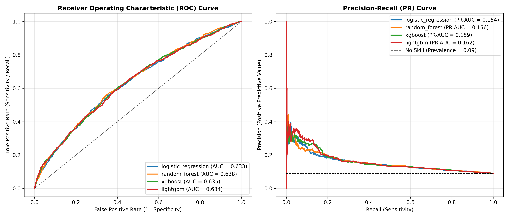
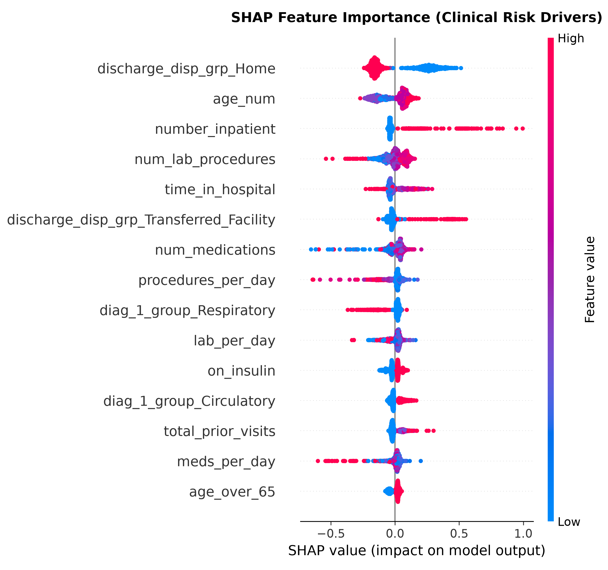
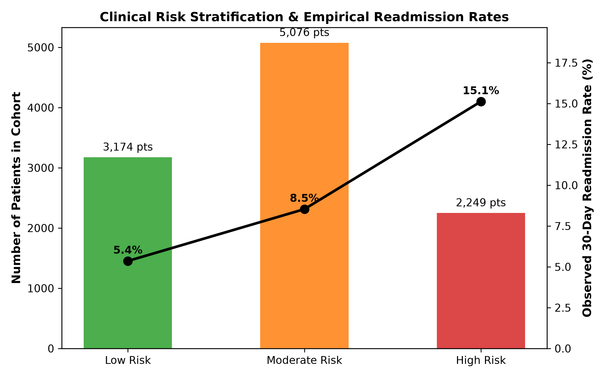

# Patient Readmission & Clinical Risk Predictive Modeling
### *Predicting 30-Day All-Cause Hospital Readmission for Diabetic Inpatients using Electronic Health Records (EHR)*


An end-to-end clinical machine learning decision support system designed to predict 30-day hospital readmission risk among diabetic inpatients. Built on 10 years of clinical EHR data across 130 US hospitals (1999–2008), this project adheres to CMS Hospital Readmissions Reduction Program (HRRP) methodology, rigorous clinical feature engineering, probability calibration, and explainable AI (SHAP).

---

## 🏥 Clinical & Business Impact

Under the **Hospital Readmissions Reduction Program (HRRP)** established by the Centers for Medicare & Medicaid Services (CMS), acute-care hospitals face up to **3% reimbursement penalties** on all Medicare discharges if their 30-day readmission rates exceed national benchmarks.

* **Clinical Goal**: Accurately stratify diabetic patients prior to discharge into actionable risk tiers (**Low**, **Moderate**, **High**).
* **Operational Value**: Enable hospital care management teams to allocate high-intensity transition-of-care interventions (e.g., 72-hour clinical follow-up, nurse navigation, pharmacist medication reconciliation) to the highest-risk patients, preventing avoidable readmissions and regulatory penalties.

---

## 🔬 Clinical Methodology & Rigorous Engineering

Most public healthcare ML implementations suffer from severe data leakage and methodological oversights. This repository resolves these issues through clinical standards:

1. **Zero Patient Leakage**: Over 16,000 patients in the dataset had multiple hospital encounters. Rather than performing random row-level splitting (which leaks encounters of the same chronic patient across train and test sets), we deduplicate to index (first) patient encounters, ensuring strict patient isolation across splits.
2. **Deceased & Hospice Exclusion**: 2,423 patients expired in the hospital or were discharged to hospice (disposition codes 11, 13, 14, 19, 20, 21). Because deceased patients cannot physiologically be readmitted to acute care, retaining them distorts the outcome definition. They are excluded per CMS HRRP guidelines.
3. **Preservation of Glycemic Indicators (HbA1c & Blood Glucose)**: In the original study (*Strack et al., 2014*), HbA1c testing was ordered in only ~18% of encounters. Treating `'None'` as missing data and dropping `A1Cresult` discards critical clinical intelligence. Here, HbA1c and glucose testing are preserved as vital markers of glycemic monitoring and control.
4. **Clinical ICD-9 Grouping**: Rather than one-hot encoding thousands of sparse ICD-9 codes, diagnoses are categorized into standard clinical classes (Circulatory, Respiratory, Digestive, Diabetes, Genitourinary, Musculoskeletal, Neoplasms, Injury, Other) and comorbidity flags.
5. **Probability Calibration**: Tree ensemble raw scores are calibrated via Platt scaling (sigmoid), ensuring that predicted probabilities reflect empirical risk ($Brier\ Score = 0.079$).

---

## 📊 Benchmark Results

### 1. 5-Fold Stratified Cross-Validation Benchmark (Training Cohort: 48,992 Patients)

| Model Architecture | 5-Fold ROC-AUC | 5-Fold PR-AUC (Avg Prec) | Brier Score (Calibration) |
| :--- | :---: | :---: | :---: |
| **Logistic Regression** (L2 Balanced) | 0.6381 ± 0.0050 | 0.1570 ± 0.0062 | 0.0798 |
| **Random Forest** (Tuned Balanced) | 0.6443 ± 0.0044 | 0.1642 ± 0.0037 | 0.0795 |
| **XGBoost** (Gradient Boosted Trees) | 0.6455 ± 0.0045 | 0.1666 ± 0.0052 | 0.0794 |
| **LightGBM** (Calibrated — **Best Model**) | **0.6458 ± 0.0064** | **0.1693 ± 0.0060** | **0.0794** |

### 2. Held-Out Unseen Test Cohort Evaluation (10,499 Patients)

* **Test ROC-AUC**: `0.6336`
* **Test PR-AUC**: `0.1616` (Base prevalence: 8.98%)
* **Brier Score**: `0.0796`

---

## ⚖️ The 91% Accuracy Paradox & Decision Threshold Optimization

In imbalanced clinical datasets where the positive outcome prevalence is ~9%, **accuracy is a dangerous and misleading metric**:

* **At Standard Default Threshold ($0.500$)**:
  * Accuracy is **91.02%** — but Sensitivity (Recall) is **0.0%**! The model predicts negative for every patient, missing **100% of readmissions** (0 True Positives, 943 False Negatives).
* **At Optimal Clinical Threshold ($0.085$, Youden's J Statistic)**:
  * Accuracy is **57.41%**, but Sensitivity (Recall) rises to **62.35%**, successfully detecting nearly two-thirds of all readmitted patients (588 True Positives detected) for targeted clinical intervention!

| Decision Threshold Strategy | Accuracy | Sensitivity (Recall) | Specificity | Precision | F1 Score | True Positives | False Negatives |
| :--- | :---: | :---: | :---: | :---: | :---: | :---: | :---: |
| **Default Threshold ($0.500$)** | 91.02% | **0.00%** | 100.0% | 0.00% | 0.000 | 0 | 943 |
| **Optimal Clinical Threshold ($0.085$)** | 57.41% | **62.35%** | 56.92% | 12.50% | **0.208** | **588** | 355 |

<p align="center">
  
</p>

---

## 🧠 Explainability & Clinical Decision Support (SHAP)

To foster clinical adoption, the model integrates SHAP (SHapley Additive exPlanations) to identify global and patient-specific risk drivers:

<p align="center">
  
</p>

### Key Clinical Drivers Identified:
1. **Prior Acute Inpatient Utilization (`number_inpatient`)**: Strongest monotonic driver of readmission. Patients with $\ge 1$ previous admission exhibit more than double the readmission rate.
2. **Discharge Disposition**: Patients discharged to skilled nursing or home health care demonstrate higher readmission vulnerability due to frailty.
3. **Glycemic Volatility & Monitoring (`A1Cresult`, `insulin`)**: Insulin dosage adjustments and elevated HbA1c ($>8\%$) reflect unstable metabolic management.
4. **Healthcare Intensity & Polypharmacy**: Higher daily medication counts (`meds_per_day`) combined with prolonged stays indicate multimorbid disease burden.

### Actionable Care Management Protocols:

<p align="center">
  
</p>

| Risk Tier | Probability Range | Actionable Transition-of-Care Protocol |
| :--- | :---: | :--- |
| **Low Risk** | $< 6.35\%$ | Routine discharge instructions; standard primary care follow-up within 14–30 days; electronic portal medication reconciliation. |
| **Moderate Risk** | $6.35\% - 11.44\%$ | Targeted diabetes self-management education; scheduled outpatient clinic appointment within 7 days; 48-hour post-discharge telephone nurse check-in. |
| **High Risk** | $> 11.44\%$ | **Intensive Care Coordination:** Dedicated nurse navigator assigned; bedside medication delivery; mandatory clinical visit within 72 hours; clinical pharmacist medication reconciliation. |

---

## 📁 Repository Structure

```
patient-readmission-risk-modeling/
├── data/
│   ├── diabetic_data.csv                       # Raw 10-year EHR dataset (101,766 encounters)
│   └── interim/                                # Cleaned, patient-deduplicated Parquet splits
│       ├── df_train.parquet
│       ├── df_val.parquet
│       └── df_test.parquet
├── model/
│   ├── best_model.pkl                          # Serialized Calibrated LightGBM Pipeline
│   └── model_metadata.json                     # Thresholds, metrics, and risk tier configs
├── notebooks/
│   ├── 01_eda_and_clinical_analysis.ipynb      # Clinical cohort profiling, exclusions & odds ratios
│   ├── 02_model_benchmarking.ipynb             # 5-fold CV, calibration curves & threshold tuning
│   └── 03_explainability_and_clinical_utility.ipynb # SHAP beeswarm plots & case studies
├── src/
│   ├── __init__.py
│   ├── config.py                               # Paths, feature groups, clinical exclusion IDs
│   ├── data_loader.py                          # Cohort filtering & patient-level splitting
│   ├── features.py                             # Scikit-learn ClinicalFeatureEngineer transformer
│   ├── pipeline.py                             # Pipeline construction & calibration factory
│   ├── train.py                                # CLI model training and evaluation script
│   ├── evaluate.py                             # ROC, PR, Brier, Youden's J & plotting utilities
│   ├── explain.py                              # SHAP analysis and risk stratification visuals
│   └── predict.py                              # Production FastAPI inference server
├── tests/
│   ├── test_features.py                        # ICD-9 mapping & feature transformation tests
│   ├── test_pipeline.py                        # Pipeline fit/predict & probability boundary tests
│   └── test_api.py                             # FastAPI endpoint integration tests
├── output_images/                              # High-resolution benchmark figures
├── Dockerfile                                  # Multi-stage production container build
├── pyproject.toml                              # Clean dependency specification managed by uv
└── uv.lock
```

---

## 🚀 Quickstart & Usage

### 1. Installation
Clone the repository and install dependencies using [Astral `uv`](https://docs.astral.sh/uv/) (or standard `pip`):

```bash
git clone https://github.com/yadaakshay/patient-readmission-risk-modeling.git
cd patient-readmission-risk-modeling

# Create virtual environment and install dependencies
uv sync
```

### 2. Run Automated Test Suite
Ensure all 8 clinical transformation and API unit tests pass:

```bash
uv run pytest tests/
```

### 3. Model Training CLI
Train candidate models, execute 5-fold cross validation, calibrate probabilities, and persist the production pipeline:

```bash
# Train full cross-validation benchmark
uv run python src/train.py --model all

# Or train LightGBM with probability calibration
uv run python src/train.py --model lightgbm --cv 5
```

### 4. Run Production FastAPI Service
Launch the clinical decision support API on port 9696:

```bash
uv run python src/predict.py
```

* Swagger UI Documentation: `http://localhost:9696/docs`
* Health Check: `http://localhost:9696/health`

### 5. API Request & Response Example

**POST** `/predict`
```json
{
  "time_in_hospital": 5,
  "num_lab_procedures": 52,
  "num_procedures": 1,
  "num_medications": 19,
  "number_outpatient": 0,
  "number_emergency": 1,
  "number_inpatient": 2,
  "number_diagnoses": 9,
  "race": "Caucasian",
  "gender": "Female",
  "age": "[70-80)",
  "admission_type_id": 1,
  "discharge_disposition_id": 3,
  "admission_source_id": 7,
  "diag_1": "428",
  "diag_2": "250.02",
  "diag_3": "585",
  "max_glu_serum": "None",
  "A1Cresult": ">8",
  "insulin": "Up",
  "change": "Ch",
  "diabetesMed": "Yes"
}
```

**Response**:
```json
{
  "readmission_probability": 0.2285,
  "readmitted_flag": true,
  "risk_tier": "High",
  "decision_threshold": 0.0847,
  "key_risk_drivers": [
    "Prior inpatient hospitalization history (2 previous admissions)",
    "Poor glycemic control: Elevated HbA1c > 8.0%",
    "Polypharmacy complexity (19 active inpatient medications)",
    "Active insulin dose titration / instability during encounter",
    "Primary cardiovascular / circulatory acute diagnosis",
    "Post-discharge transitional care need: Discharged with Home Health Care or SNF"
  ],
  "clinical_action_plan": "URGENT: High 30-day readmission risk. Enroll patient in intensive transition-of-care program. Schedule clinical follow-up within 72 hours of discharge, assign a nurse navigator, and conduct full clinical pharmacist medication reconciliation."
}
```

---

## 🐳 Docker Deployment

Build and run the containerized service:

```bash
docker build -t patient-readmission-service:2.0 .
docker run -p 9696:9696 patient-readmission-service:2.0
```

---

## 📜 References & Acknowledgements
* Strack, B., DeShazo, J. P., Gennings, C., Olmo, J. L., Ventura, S., Cios, K. J., & Clore, J. N. (2014). *Impact of HbA1c Measurement on Hospital Readmission Rates: Analysis of 70,000 Clinical Database Records*. BioMed Research International, 2014.
* Centers for Medicare & Medicaid Services (CMS). *Hospital Readmissions Reduction Program (HRRP)*.
